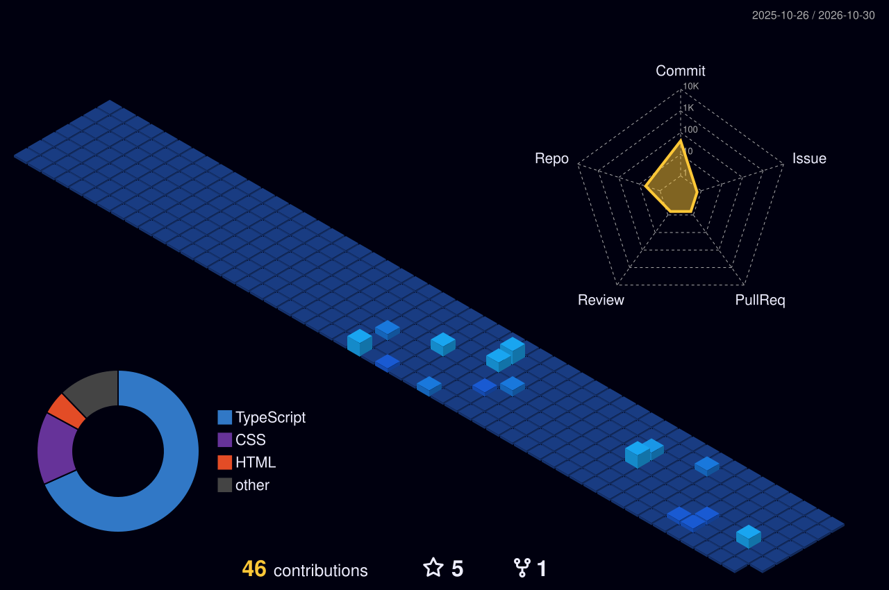

<!-- ═══════════════════════════ CABECERA ═══════════════════════════ -->

  

  

  
  
  

---

## 👋 Hola, soy Jared

Estudiante de **Ingeniería de Software con IA**, enfocado en el desarrollo de aplicaciones web **Full Stack** y en la integración de **Inteligencia Artificial**.  
Me gusta transformar necesidades reales en software moderno, funcional y escalable.

- 🎓 Estudiante de Ingeniería de Software con IA
- 💻 Desarrollo de aplicaciones Full Stack (frontend, backend y base de datos)
- 🤖 IA aplicada al software: asistentes, automatización e integraciones
- 🗄️ Bases de datos, APIs REST y autenticación con JWT
- ☁️ Cloud, despliegue y arquitectura de software
- 🚀 Enfocado en resolver problemas reales de negocio

---

## 🛠️ Tecnologías

<b>Lenguajes</b>  
  

<b>Frontend</b>  
  

<b>Backend y bases de datos</b>  
  

<b>Cloud, DevOps y herramientas</b>  
  

<b>Inteligencia Artificial y automatización</b>  
  
  
  
  

---

## 🚀 Proyectos destacados

  
  

### 🎓 Plataforma de cursos — Soluciones Integrales JB
Plataforma educativa Full Stack para la empresa **Soluciones Integrales JB S.A.C.**: cursos con módulos y lecciones en video, progreso del alumno, **certificados con ID verificable**, recursos descargables, blog conectado a las redes de la empresa, panel de administración y modo claro/oscuro.

`Next.js` `NestJS` `TypeScript` `Supabase` `PostgreSQL` `TypeORM` `Tailwind CSS` `JWT`

### 🌐 Soluciones Integrales JB — Web corporativa
Plataforma web corporativa con frontend, backend, base de datos y un **asistente virtual con IA**.

`React` `TypeScript` `Vite` `Node.js` `Express` `MySQL` `Ollama` `Vercel`

---

## 📊 Estadísticas de GitHub

  
  

  

## 🏙️ Contribuciones en 3D

  

  <picture>
    <source media="(prefers-color-scheme: dark)" srcset="./profile/snake-dark.svg" />
    <source media="(prefers-color-scheme: light)" srcset="./profile/snake.svg" />
    
  </picture>

---

## 💼 Experiencia

- 🌐 Desarrollo y mantenimiento de plataformas web
- 💻 Desarrollo Full Stack
- 🗄️ Gestión y administración de bases de datos
- 🐘 Desarrollo y modificación de soluciones PHP / WordPress
- 🔧 Soporte técnico y resolución de incidencias
- 🏢 Soluciones orientadas a procesos empresariales
- 🤖 Integración de herramientas de Inteligencia Artificial

## 📚 Actualmente aprendiendo

`Arquitectura de Software` · `Diseño de sistemas escalables` · `Cloud y despliegue` · `Agentes de IA` · `Buenas prácticas y testing`

## 🎯 Objetivo profesional

Desarrollarme como **Ingeniero de Software**, combinando desarrollo Full Stack, arquitectura de software e Inteligencia Artificial para construir soluciones eficientes, con impacto y orientadas a problemas reales.

---

<b>🚀 Construyendo software · Aprendiendo continuamente · Explorando la IA</b>

  

